<p align="center">
  <a href="https://16-launcher.ru">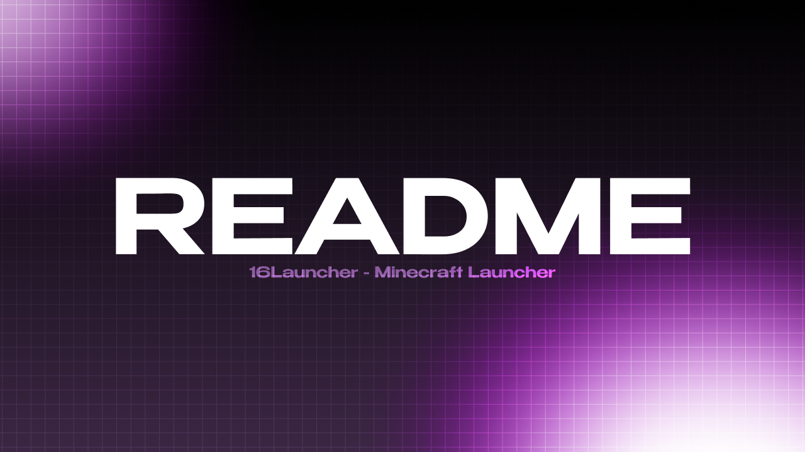</a>
  <h1 align="center">16Launcher</h1>
<p align="center">
  <em>Reliable cross-platform Minecraft launcher. Built-in mod management, advanced optimization, and clean UI. Lightweight, stable, with flexible settings for full control over the game.</em>
</p>

<p align="center">
  
  
  
  
</p>

---

**Source Code**: [https://github.com/launcherdev11/rust-launcher](https://github.com/launcherdev11/rust-launcher)

**Website**: [https://16-launcher.ru](https://16-launcher.ru)

---

<p align="center">
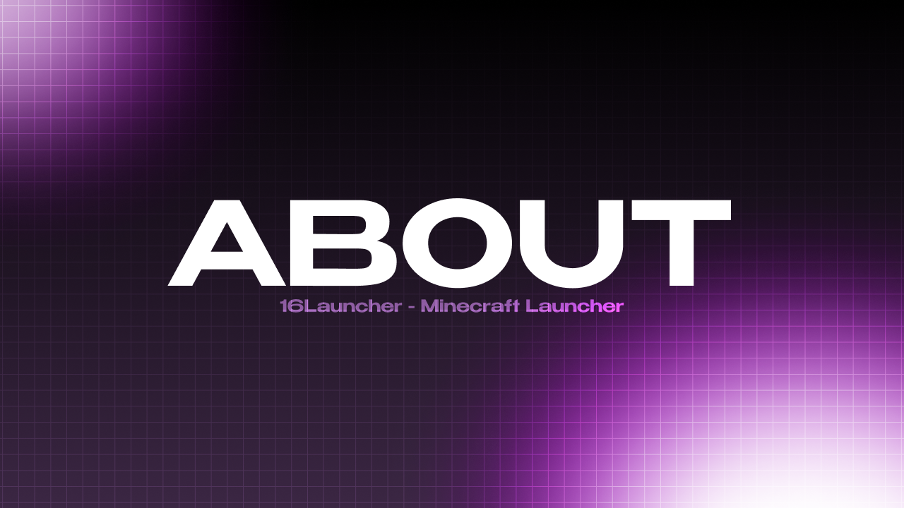
</p>

---
    
**16Launcher** - Reliable cross-platform Minecraft launcher. Built-in mod management, advanced optimization, and clean UI. Lightweight, stable, with flexible settings for full control over the game.

**Languages**: [Русский](README.ru.md)

<p align="center">
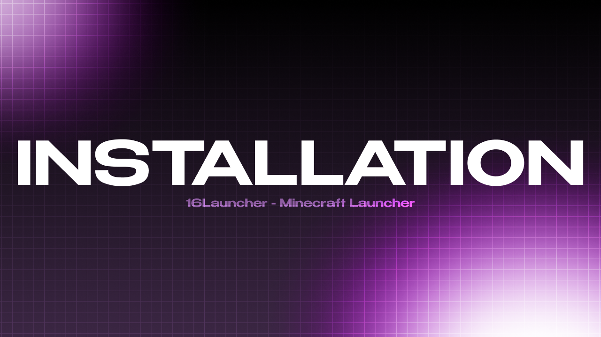
</p>

## Installation

1. Download the latest installer from [Official website](https://16-launcher.ru)
2. Run the installer and follow the setup instructions
3. Launch 16Launcher and start playing!


## Features

- **Fast & Optimized**: Quick startup and smooth performance
- **Multi-Version Support**: Play any Minecraft version from classic to latest
- **Secure**: Regular updates and security patches
- **Mod Management**: Easy mod installation and organization
- **Custom Themes**: Install and create your own CSS themes

## Quick Start

1. **Download** the launcher from our [official website](https://16-launcher.ru)
2. **Install** following the instructions for your operating system
3. **Select** your preferred Minecraft version
4. **Click Play** and enjoy!

<p align="center">
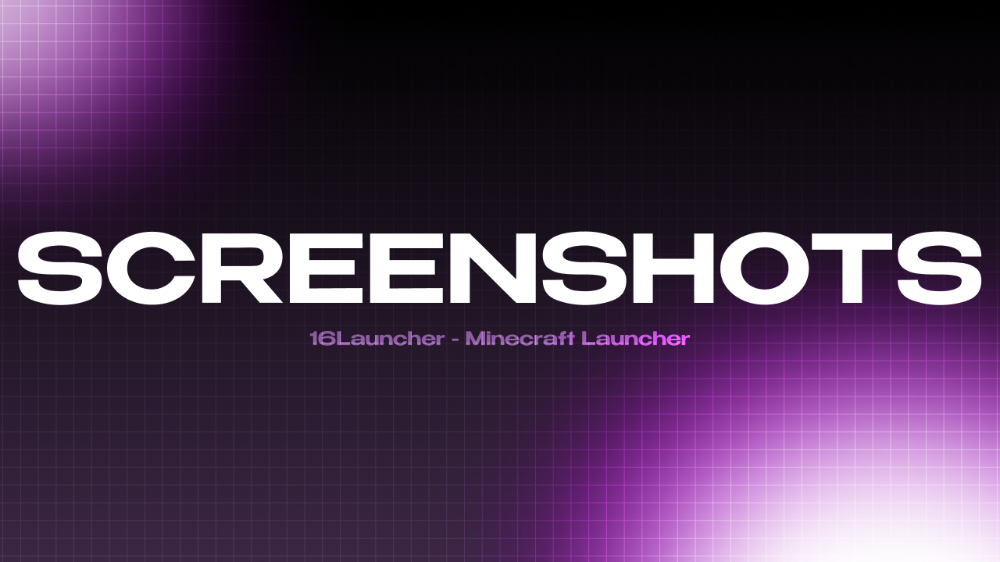
</p>

# Screenshots

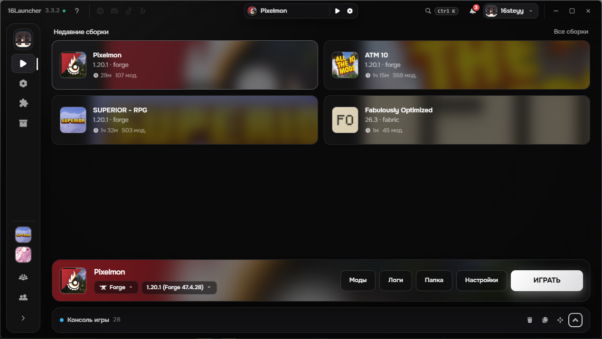
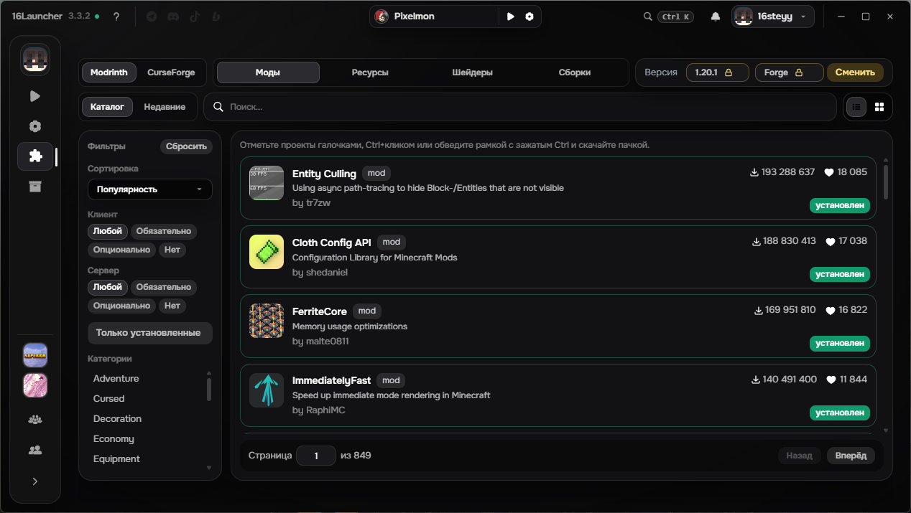
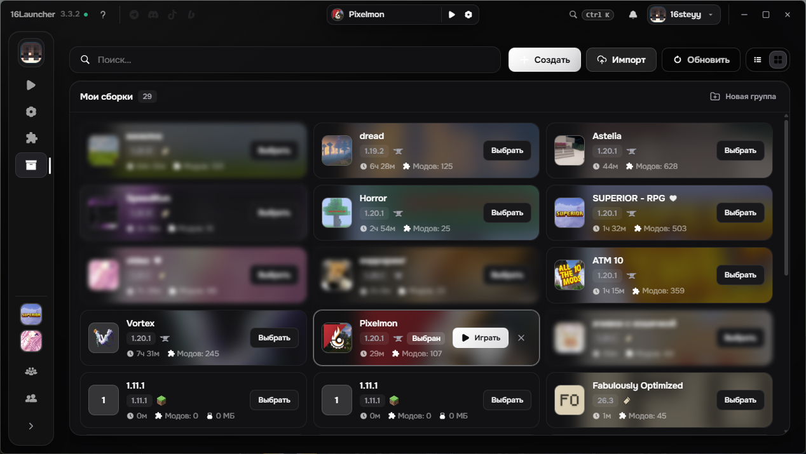
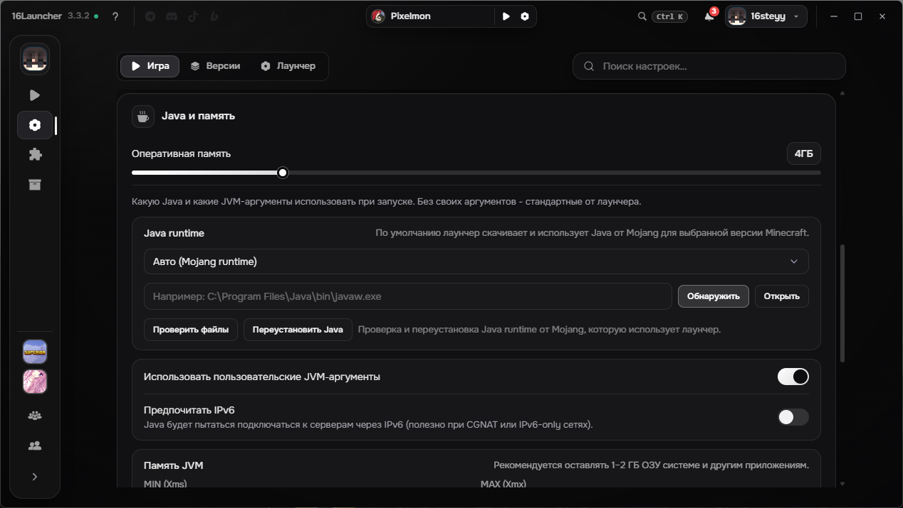
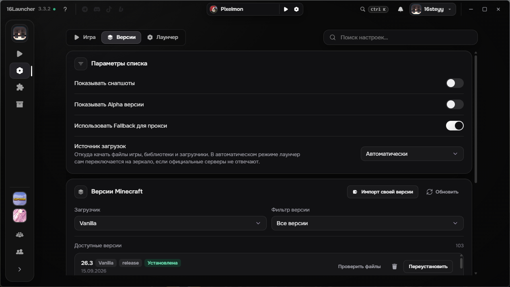
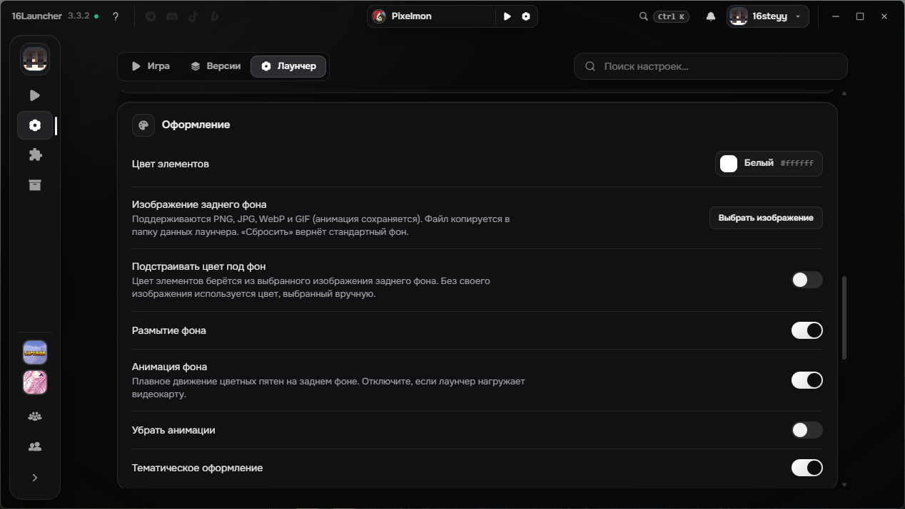
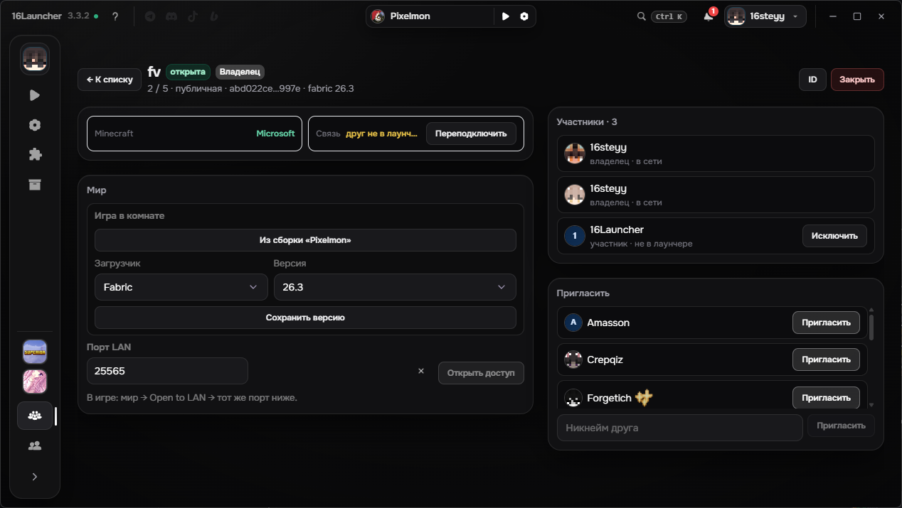
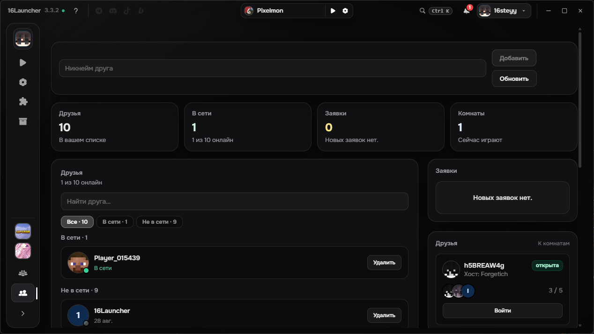
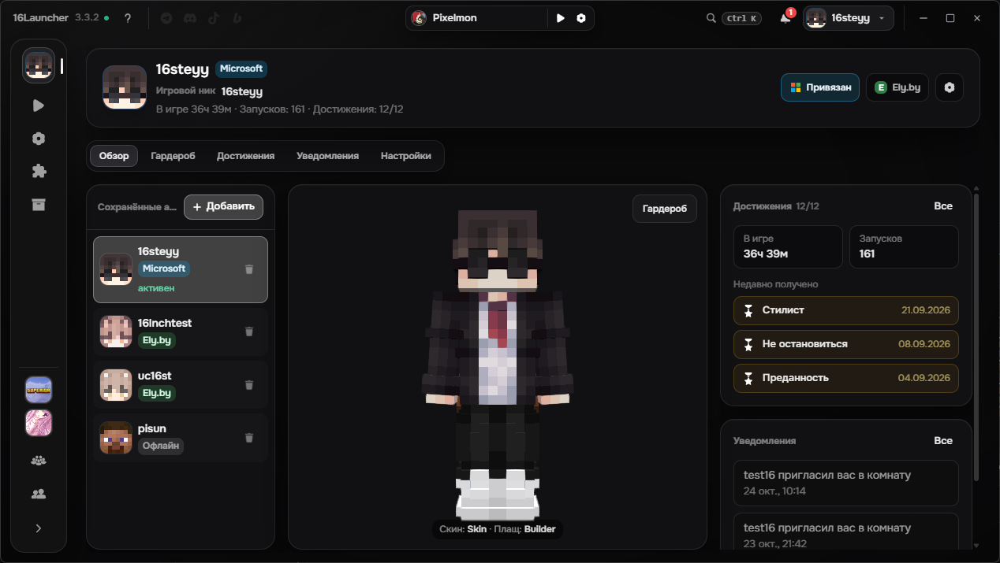

## Building from source

The launcher is built with Tauri 2: a Rust backend in `src-tauri/` and a React 19 + TypeScript + Vite + Tailwind frontend in `src/`.

You need Node.js 22, a stable Rust toolchain and the system libraries for Tauri (WebView2 and MSVC Build Tools on Windows, WebKitGTK 4.1 on Linux).

```bash
npm ci
npm run tauri dev      # run in development mode
npm run tauri build    # produce installers in src-tauri/target/release/bundle/
```

Full instructions, including platform dependencies, environment variables, updater signing and the release process, are in [BUILD.md](BUILD.md).

<p align="center">
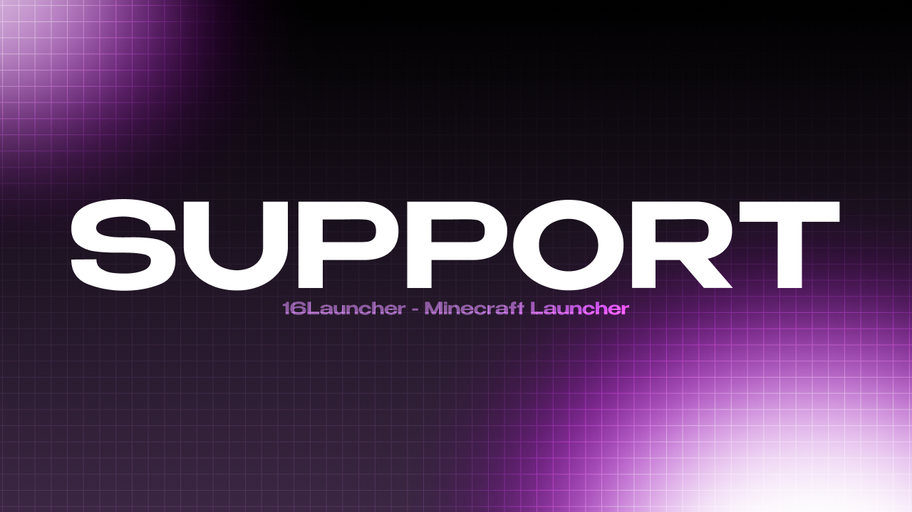
</p>

## Support

- Email: 16launcher@gmail.com
- Website: [https://16-launcher.ru](https://16-launcher.ru)
- Issues: [GitHub Issues](https://github.com/launcherdev11/rust-launcher/issues)

<p align="center">
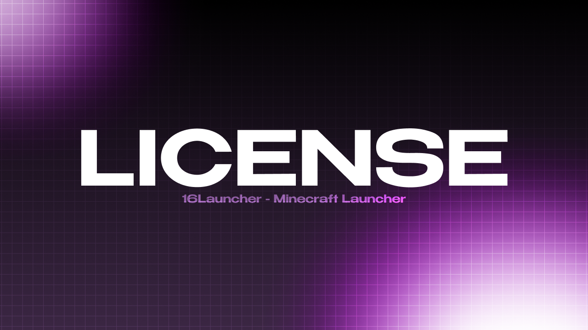
</p>

## License

This project is licensed under the terms of the GPL-3.0 license.